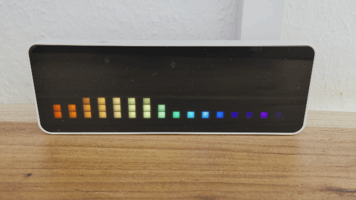
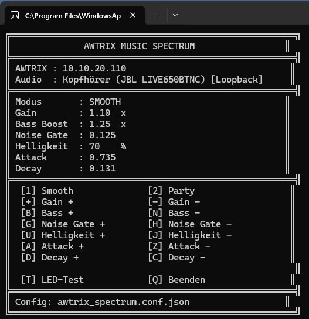

# AWTRIX Art-Net Spectrum

Real-time audio spectrum analyzer for **AWTRIX NG** and the **Ulanzi TC001**, using Windows WASAPI loopback audio capture and Art-Net.

The application captures the current Windows system audio, performs an FFT analysis and displays the resulting frequency spectrum directly on the Ulanzi TC001's **32×8 RGB matrix**.

No MQTT broker or additional service is required.




```text
Windows Audio
     │
     ▼
WASAPI Loopback
     │
     ▼
     FFT
     │
     ▼
16 Frequency Bands
     │
     ▼
32×8 RGB Frame
     │
     ▼
Art-Net / UDP 6454
     │
     ▼
AWTRIX NG
     │
     ▼
Ulanzi TC001
```

## Features

- Real-time Windows system audio capture
- FFT-based spectrum analysis
- Native Art-Net output
- Designed for the Ulanzi TC001 32×8 matrix
- 16 frequency bands
- One-pixel-wide spectrum bars
- One empty pixel column between bars
- Static frequency-based colors
- Bass boost
- Adjustable gain
- Adjustable noise gate
- Adjustable brightness
- Adjustable attack and decay
- Smooth mode
- Party mode without temporal smoothing
- Runtime keyboard controls
- Persistent configuration
- Automatically restores the previous settings on startup
- No MQTT required
- No modification of AWTRIX NG required

---

## Requirements

### Hardware

- Pixel-Matrix (for example Ulanzi TC001)
- AWTRIX NG firmware

### Software

- Windows (in this case)
- Python 3
- AWTRIX NG with Art-Net enabled

Python packages:

```powershell
python -m pip install numpy PyAudioWPatch
```

---

# AWTRIX NG configuration

Open the AWTRIX NG web interface and enable **Art-Net** under Misc (Sonstiges) -> Art-Net.

Art-Net uses:

```text
Protocol: UDP
Port:     6454
```

The TC001 contains:

```text
32 × 8 = 256 RGB pixels
```

The application sends the matrix using two Art-Net universes.

```text
Universe 0:
Pixels 0–169

Universe 1:
Pixels 170–255
```

---

# Installation and Configuration

Open:

```text
awtrix_spectrum.py
```

and set the IP address of your AWTRIX device:

```python
AWTRIX_IP = "YOUR_AWTRIX_IP"
```

Replace the example address with the actual IP address of your Ulanzi TC001.

---

# First start

Run:

```powershell
python .\awtrix_spectrum.py
```

The application automatically uses the default Windows WASAPI loopback device.

This means the spectrum reacts to the audio currently being played through the default Windows output device.

Examples:

- Spotify
- YouTube
- games
- browser audio
- media players
- system audio

---
# Modes

## Smooth

Smooth mode uses separate attack and decay values.

A frequency peak rises quickly but falls more gradually.

This produces a calmer spectrum display.

Example:

```text
Peak occurs
     │
     ▼
████████
███████
██████
█████
████
███
██
█
```

This is the default mode.

---

## Party

Party mode disables temporal smoothing.

The currently measured FFT level is displayed immediately.

If a frequency disappears, its pixels disappear on the next frame.

```text
Frame 1  ████████
Frame 2  █████
Frame 3  ██
Frame 4
```

There is no decay or afterglow in Party mode.

---

# Keyboard controls

The application can be configured while it is running.

```text
1       Smooth mode
2       Party mode

+       Increase gain
-       Decrease gain

B       Increase bass boost
N       Decrease bass boost

G       Increase noise gate
H       Decrease noise gate

U       Increase brightness
J       Decrease brightness

A       Increase attack
Z       Decrease attack

D       Increase decay
C       Decrease decay

T       LED / matrix test

Q       Quit
```

The console displays the current configuration as a fixed dashboard instead of continuously printing new status lines.

---

# Persistent configuration

Runtime settings are automatically stored in:

```text
awtrix_spectrum.conf.json
```

The file is created in the same directory as:

```text
awtrix_spectrum.py
```

Example directory:

```text
awtrix-artnet-spectrum/
├── awtrix_spectrum.py
├── awtrix_spectrum.conf.json
└── README.md
```

Whenever a setting is changed using the keyboard, the configuration is saved automatically.

The previous configuration is restored when the program starts again.

---

# Recommended default configuration

The following values provide a good starting point for the Ulanzi TC001:

```json
{
    "mode": "smooth",
    "gain": 1.2,
    "bass_boost": 1.25,
    "noise_gate": 0.125,
    "brightness": 1.0,
    "attack": 0.45,
    "decay": 0.131
}
```

These settings are intentionally only a starting point.

Audio levels differ depending on:

- Windows volume
- audio interface
- application
- music mastering
- output device

---

# Setting Gain

Gain controls the overall sensitivity of the spectrum analyzer.

Higher values produce taller bars.

Example:

```text
0.8x    low sensitivity
1.2x    recommended starting point
1.5x    high sensitivity
2.0x+   very sensitive
```

If most bars constantly reach the top of the display, reduce Gain.

If the display barely reacts, increase Gain.

---

# Bass Boost

Bass Boost increases the weighting of the lower frequency bands.

Recommended starting value:

```text
1.25
```

Higher values make bass drums and low-frequency effects more prominent.

Example:

```text
1.0     no additional boost
1.25    moderate
1.5     strong
2.0     very strong
```

---

# Noise Gate

The noise gate prevents very low-level signals from continuously lighting pixels.

Recommended starting value:

```text
0.125
```

Increase the value if the display keeps moving while the audio is nearly silent.

Decrease it if quiet parts of music disappear too aggressively.

---

# Brightness

Controls the RGB output brightness.

Range:

```text
0.0 – 1.0
```

Default:

```text
1.0
```

Example:

```text
0.25    25%
0.50    50%
0.75    75%
1.00    100%
```

---

# Attack

Attack determines how quickly the Smooth mode reacts when a frequency becomes louder.

Recommended:

```text
0.45
```

Higher values react faster.

Lower values are smoother.

```text
0.20    soft
0.45    balanced
0.70    fast
1.00    immediate
```

Attack is not used by Party mode.

---

# Decay

Decay determines how quickly a bar falls after the audio level decreases.

Recommended:

```text
0.131
```

Lower values produce a slower fall.

Higher values make bars disappear faster.

```text
0.05    slow
0.10    smooth
0.131   recommended
0.25    fast
0.50    very fast
```

Decay is not used by Party mode.

---

# Matrix test

Press:

```text
T
```

to display a full-height test pattern.

The test shows all 16 spectrum columns while leaving the configured gap columns black.

---


# Troubleshooting

## `ModuleNotFoundError: No module named 'numpy'`

Install NumPy using the same Python installation used to execute the application:

```powershell
python -m pip install numpy
```

---

## `ModuleNotFoundError: No module named 'pyaudiowpatch'`

Run:

```powershell
python -m pip install PyAudioWPatch
```

---

## Nothing appears on the TC001

Check:

1. Art-Net is enabled in AWTRIX NG.
2. `AWTRIX_IP` contains the correct IP address.
3. The PC can reach the TC001.
4. UDP port `6454` is not blocked by a firewall.
5. The TC001 and PC have network connectivity between their respective VLANs/subnets.

A basic connectivity test can be performed with:

```powershell
ping 10.10.10.10
```

Replace the IP address with your TC001 address.

---
# License
MIT
